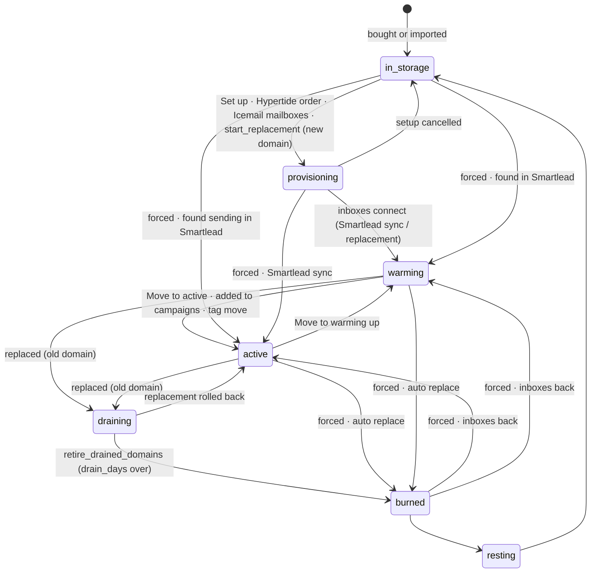
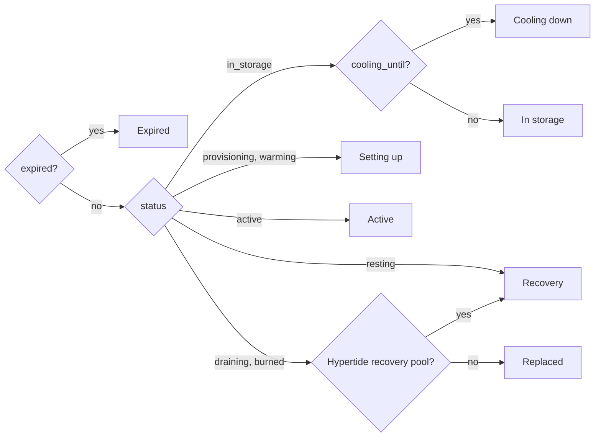
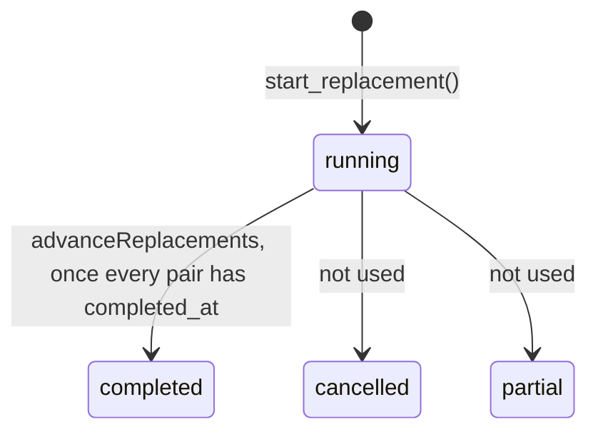
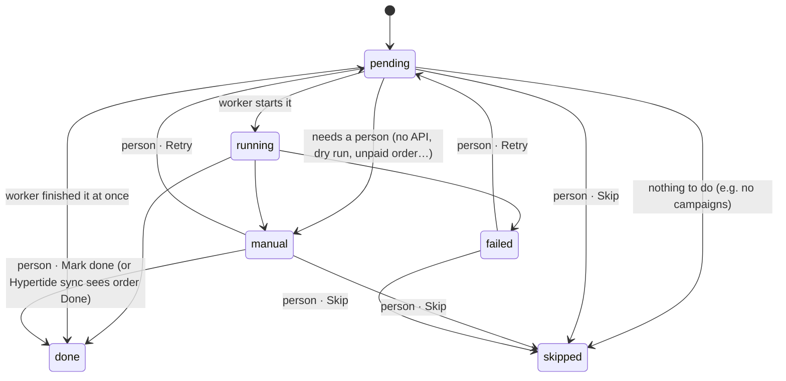
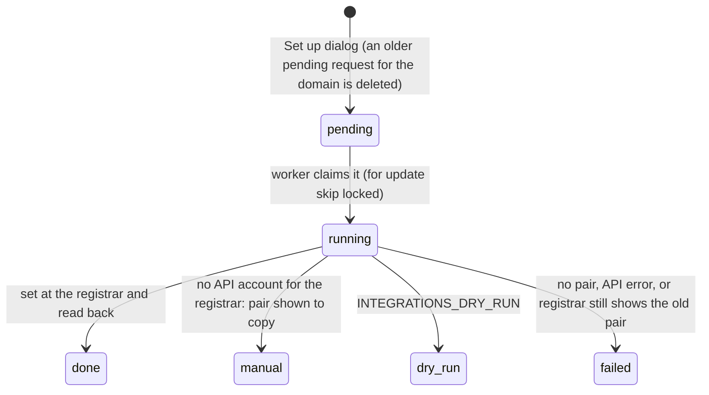
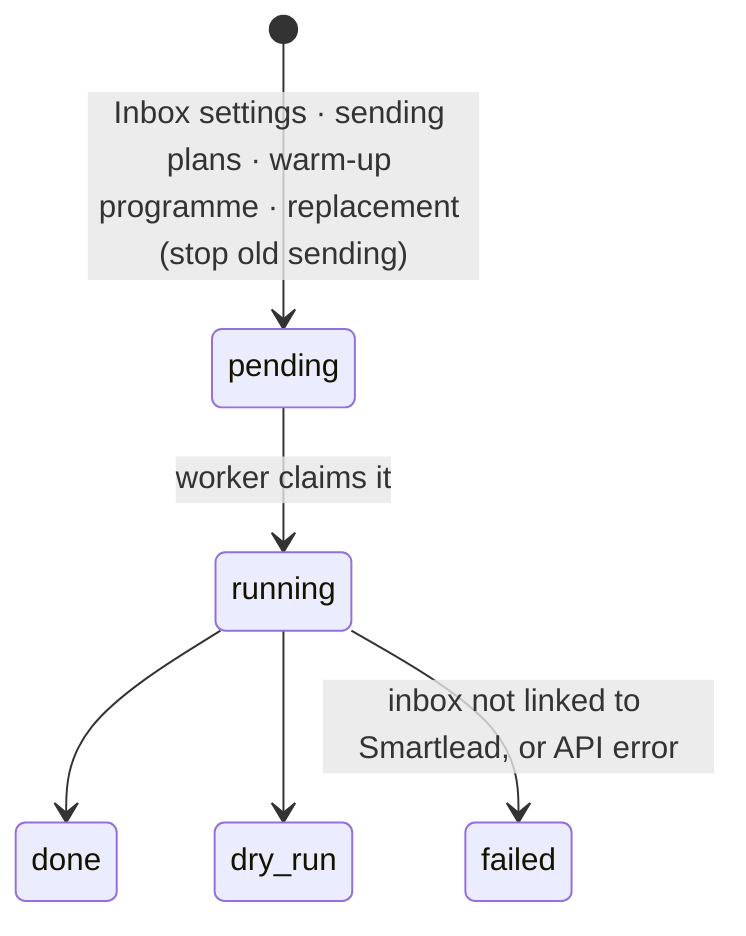
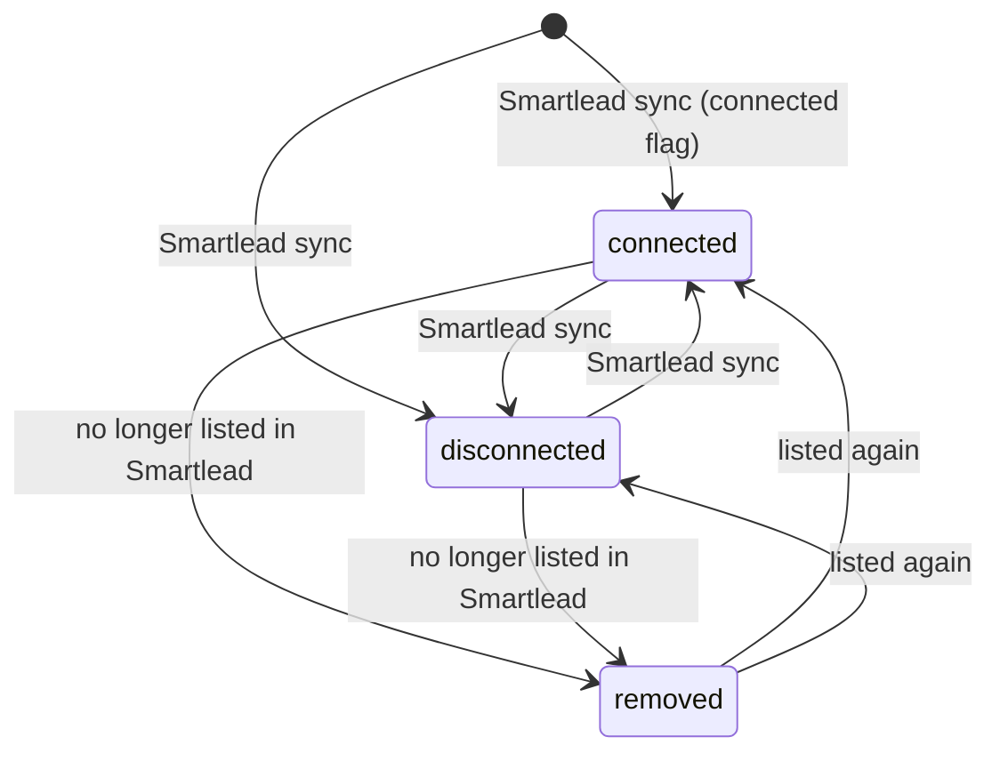
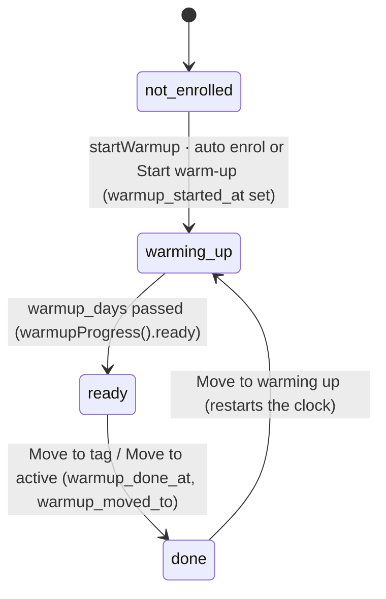

# State machines in Domain Engine

Domain Engine has one main state machine, the domain lifecycle, and a dozen
smaller ones around it. Most of them were implicit until now: status columns
with no list of states, moves spread across actions, jobs and SQL, and copies
of the same rule in TypeScript and SQL.

This page lists each machine, with:

- its states and allowed moves;
- who makes each move;
- what must always hold;
- where the rule is written more than once.

The **typed source** line under each machine is the one place to change it.
`tests/state-machines.test.ts` checks that the TypeScript and the database
still agree.

Who makes a move:

- **Person**: a server action in `src/app/actions.ts`, from a button.
- **Job**: the worker, `src/jobs/*`, scheduled in `src/jobs/index.ts`.
- **SQL**: a database function the jobs call.

---

## 1. Domain lifecycle: `domains.status`

**Typed source:** `src/lib/status.ts`. It holds `DOMAIN_STATUSES`,
`NEXT_STATUSES`, `canMove`, `FORCED_MOVES` and the status groups
`IN_USE_STATUSES`, `REPLACEABLE_STATUSES`, `RETIRED_STATUSES` and
`FLEET_STATUSES`.

**Database:** the `domain_status` enum and the `domain_transitions` table.
Every move goes through `transition_domain()`, which writes a row to
`domain_status_history`.

### Normal moves

These are the rows of `domain_transitions`. `transition_domain()` accepts
them without force.

| From | To | Who |
|---|---|---|
| in_storage | provisioning | Person: Set up (`setupDomains`). Job: Hypertide sync (live order) and Icemail sync (mailboxes). SQL: `start_replacement` (new domain). |
| provisioning | in_storage | Person: Status dialog (setup cancelled) |
| provisioning | warming | Job: replacement steps (Smartlead step done). Job: Smartlead sync (inboxes connected, outside a replacement). |
| warming | active | Person: Move to active (`markWarming`), Move to tag. Job: replacement (campaigns step done). |
| active | warming | Person: Move to warming up (added in 0033) |
| warming / active | draining | Job: replacement `startGrace`, once the new domain is live or Hypertide has swapped it |
| draining | active | Person: Status dialog (replacement rolled back) |
| draining | burned | SQL: `retire_drained_domains()`, after `drain_days` |
| burned | resting | Person: Move to recovery |
| resting | in_storage | Person: Status dialog |

### Forced moves

The app also makes moves that skip the table, by passing force and a reason.
These are listed in `FORCED_MOVES`, and a test checks that each one still
needs force.

| Move | Who |
|---|---|
| in_storage or provisioning → active or warming | Smartlead sync: daily limit set → active, otherwise warming |
| active or warming → burned | `replace_dropped_domains()`, actor `auto replace` |
| burned → active or warming | `replace_dropped_domains()` undoing its own move: only when the last history row is `auto replace` |
| anything not retired → burned | Mark as replaced |
| anything except resting → resting | Move to recovery |
| any → any | Status dialog with "Override and move", which needs a reason |

### Rules that always hold

- Only `transition_domain()` changes `status`, apart from inserts. Each change
  writes a history row with the actor and the reason.
- A forced move needs a reason that isn't blank.
- Moving to the same status changes nothing and writes no history.
- Side effects of a move:
  - to active: sets `active_since`, which a draining → active rollback keeps;
  - to draining: sets `draining_since`, which a move to active clears;
  - to burned: sets `burned_at`;
  - to in_storage: clears `client_id`.
- `start_replacement()` only accepts an old domain that is active or warming
  (`REPLACEABLE_STATUSES`), and a new domain that is in_storage.

### Status groups

These are named in `status.ts` and used in TypeScript. Their SQL copies are
listed in §15.

| Group | Statuses | Used by |
|---|---|---|
| `IN_USE_STATUSES` | provisioning, warming, active | Expiring tab (`isInUse`), Validate DNS with nothing ticked (`validateDns`), Overview expiry warnings |
| `REPLACEABLE_STATUSES` | active, warming | Replace button (Domains, Expiring, domain sheet, Inboxes), `start_replacement` |
| `RETIRED_STATUSES` | draining, burned, resting | `domain_standing` "retired", Mark as replaced skips these |
| `FLEET_STATUSES` | active, warming, provisioning, draining | Overview fleet bar, Clients table |

## 2. Views over the lifecycle

These are derived from status and other facts. They are not stored and have
no moves of their own. Pages filter on them, so they are listed here to keep
their wording consistent.

### Inventory tab: `lifeOf` in `src/lib/lifecycle.ts`

### Where a domain really stands: `domain_standing` view (0029)

- **Typed in:** `Standing` in `src/lib/review.ts`.
- **States**, checked in this order: expired, grace, replaced, cancelled,
  retired, disconnected, deleted, not_connected, no_order, active.
- **Current** means active or grace (`isCurrent`).
- The view's `order_state` can be active, pending, cancelled, gone, replaced or
  missing. The Hypertide order and Icemail mailboxes in §9 decide it.

### Smartlead state: `slState` in `src/lib/smartlead-state.ts`

- Comes from the inbox counts: live, partial, disconnected, deleted, none.
- **Duplicate:** `InboxesView` recomputes the same split from counts in
  `notLive`.

### Free: `domain_is_free()` (0036)

- A domain is free when all of these hold:
  - it is in_storage;
  - it isn't expired;
  - it has default nameservers, or none;
  - `domain_ever_used()` is false.
- **Mirror:** `isDefaultNs` in `lifecycle.ts` mirrors `ns_is_default()`.
- **Deliberate difference, pinned by a test:** an empty list counts as default
  in SQL, so a domain with no nameservers is free. `nsOf` shows None or Not
  checked before it ever calls `isDefaultNs`.

## 3. Replacement batch: `replacement_batches.status`

**Typed source:** `BATCH_STATUSES` in `status.ts`.

- Only running → completed happens.
- Nothing sets partial or cancelled.
- Queries still leave out `status = 'cancelled'`, so a batch cancelled by hand
  in the database drops out of every page.

## 4. Replacement pair: the four steps on `replacement_items`

**Typed source:**

- `STEP_STATUSES`, `isStepFinished` and `stepWaitsOnPerson` in `status.ts`;
- `STEP_ORDER` and `currentStep` in `src/jobs/replacements.ts`.

**Database:** the `step_status` enum, used by `step_nameservers`,
`step_inboxes`, `step_smartlead` and `step_campaigns`.

The steps run in order: nameservers → inboxes → smartlead → campaigns. The
current step is the first one that isn't done or skipped. Each step has its
own status:

**Rules:**

- Only the current step can be acted on. `actOnStep` refuses any other step
  ("Finish the earlier steps first").
- The worker leaves a step alone while it is manual or failed.
- When campaigns finishes, the pair gets `completed_at`. It is never cleared.

**Domain moves that follow the steps** (`syncStatuses`):

- Smartlead finished: the new domain goes provisioning → warming.
- Campaigns done: the new domain goes to active, and the old domain goes to
  draining if it was active or warming.
- Campaigns skipped: the new domain stays warming until someone adds it to
  campaigns.
- Hypertide replace batches: the old domain starts draining as soon as
  Hypertide has swapped it.

**Sub-states on the pair:**

- **Hypertide operation** (`ht_operation`): Hypertide's words (queued,
  completed, failed, expired, cancelled, rejected). The inbox step fails on
  failed, expired, cancelled or rejected.
- **Order payment:**
  - `hypertide_status` goes Unpaid → Paid (Approve payment), then
    Hypertide's own status up to Done;
  - `hypertide_paid_at` is set by Approve payment;
  - `hypertide_ns_verified_at` is set once the nameservers are verified.

**Row state in the UI** (`stateOf` in `ReplacementsView`):

- attention: any step is manual or failed;
- progress: not completed yet;
- warming: completed and campaigns skipped;
- live: completed and campaigns done.

## 5. Nameserver change: `nameserver_requests.status`

**Typed source:** `NS_REQUEST_STATUSES` and `OPEN_QUEUE_STATUSES` in
`src/lib/states.ts`.

- The finished states are final. A new Set up queues a new request.
- The Domains nameserver cell (`nsOf`) shows the latest request from the last
  14 days:
  - pending or running: Switching;
  - manual: Manual;
  - failed: Failed;
  - dry_run: Dry run.
- Domains polls every 5 s while any request is pending or running.

## 6. Inbox setting change: `inbox_setting_changes.status`

**Typed source:** `SETTING_CHANGE_STATUSES` in `states.ts`.

- Changes to the same inbox are merged oldest first and sent in one call.
- There is no manual state, because every change can go through the API.

## 7. Inbox: `inboxes.status`

**Typed source:** `INBOX_STATUSES` in `states.ts`.

- Only the Smartlead sync writes this column.
- `pending` is the column's default, but nothing sets it.

## 8. Hypertide order: `hypertide_orders`

**Typed source:** `HT_DONE`, `HT_CANCELLED`, `isHtCancelled` and
`inRecoveryPool` in `states.ts`.

- **Status:** Hypertide's own words, Todo → In progress → Done. NPC and
  Cancelled both mean cancelled; NPC is what the API calls the dashboard's
  Cancelled.
- **Payment:** Paid or Unpaid, or a recovery-pool value.
- **Fields the Hypertide sync keeps:**
  - `gone_at` is set when the order stops being listed, and cleared when it
    comes back;
  - `ended_on` is set the first time the order is seen cancelled or gone;
  - `replaced_domains` records names the order carried before a swap.
- **Moves it drives:**
  - a live order (not gone, and not NPC or Cancelled) on an in_storage
    domain moves it to provisioning;
  - Done on a manual replacement completes that pair's inbox step.

**Where the same words are checked:**

| Check | Places |
|---|---|
| Done, not gone | `actions.ts` (`loadReplaceOptions`, `startReplacement`), `jobs/replacements.ts`, `jobs/hypertide-sync.ts` |
| Cancelled = NPC or Cancelled | `hypertide-sync.ts` (twice), `domain_standing` (0029), `replace_dropped_domains` (0036 and 0037), `queries.ts` `listInboxes`, `htOf` |
| Recovery pool = `/recovery/i` on payment | `inRecoveryPool`, used by `lifeOf` and `htOf` |

`htOf` used to recognise only NPC as cancelled. A Cancelled order showed as a
blue "Cancelled" in the Hypertide column; it now shows the same grey
"Cancelled" as NPC. The label didn't change, only the colour.

## 9. Icemail domain and mailbox

- `icemail_domains.active` and `icemail_mailboxes.status` are Icemail's words.
  The Icemail sync sets `gone_at` when Icemail stops listing them.
- A mailbox has **ended** when it is gone, or its status matches
  `cancel|delet`. Only `replace_dropped_domains()` (0037) reads this.
- Mailboxes that aren't gone move an in_storage domain to provisioning
  (Icemail sync).
- `domain_standing` gives an Icemail order the state gone, active, pending or
  missing.

## 10. Automatic moves: `replace_dropped_domains()` and `retire_drained_domains()`

**`replace_dropped_domains()`** runs after each Smartlead, Hypertide and
Icemail sync.

- **It moves an active or warming domain to burned (forced) when all hold:**
  - it has no inbox left in Smartlead other than removed ones;
  - it has been with a vendor;
  - nothing is live at Hypertide or Icemail;
  - it isn't in a running replacement.
- **It undoes its own move** when connected inboxes come back: to active if
  any inbox has a daily limit, otherwise to warming. It only does this when the
  last history row was its own (actor `auto replace`).

**`retire_drained_domains()`**, the drain job: draining → burned once
`draining_since` is older than `drain_days`.

## 11. Warm-up programme: `domains.warmup_*`

The state is spread over three timestamps rather than one column:

- This is separate from `domains.status = 'warming'`, which the Move to warming
  up / Move to active buttons switch.
- Inboxes defines "warming up" as `warmup_started_at` set and `warmup_done_at`
  null. The same rule is written in `InboxesView` and `MoveToTagDialog`.

## 12. Alerts and snoozes

- `alerts.status` uses the `alert_status` enum. A health rule opens an alert,
  and a person snoozes it for 3 days or resolves it (`updateAlert`): open →
  snoozed or resolved, and snoozed → resolved.
- There is at most one alert per domain and rule that isn't resolved (a unique
  index).
- `fix_snoozes` puts a fix-queue problem off until a date, keyed by domain name
  and problem kind. Once the date passes the problem shows again.

## 13. Job runs: `job_state`

- `runJob` sets `last_started_at` when a job starts. When it ends it sets
  `last_finished_at` and `last_ok`, plus `last_detail` on success or
  `last_error` on failure.
- A job is running while `last_started_at > last_finished_at`.
- The Icemail webhook clears `last_started_at` so the next tick runs the
  Icemail sync at once.

## 14. Fix queue tiers: `src/lib/fix-queue.ts`

- This is a ranking, not a machine. Each problem gets a tier: urgent (Fix
  today), soon (This week) or watch (Keep an eye on).
- A domain takes its worst problem's tier.
- Domains in grace only show `grace_ending`.
- Domains that are neither current nor on a live order only show
  `sending_after_end`.

## 15. Client-side flows

| Component | States | Notes |
|---|---|---|
| `ReplaceDialog` | loading → editing → submitting → closed / error. Mode is hypertide or manual. | Ready when nothing is short, every pair is assigned, names are valid and none is refused. Reopening keeps the last mode and checkboxes. |
| `SetupDialog` | Nameserver mode is leave, hypertide or custom. | Defaults to hypertide when any target is in storage. Resets on open. |
| `ChangeStatusDialog` | Pick a status → override when a move isn't allowed (`canMove`) → submit | Lists every status. A move outside the table needs a reason. |
| `MarkReplacedDialog` | to is replaced or recovery; null means closed | |
| `InboxSettingsDialog` | Three cards, each with busy and error. Limit mode is set, random or split. | |
| `DiagnosisCard` | idle / running / error / has diagnosis. Feedback is right, wrong or none. | Feedback updates at once and rolls back if saving fails. |
| `SyncPanel` | idle / one job running / a queue of jobs | |
| `AutoRefresh` | On while some condition holds | Domains: while a nameserver request is pending or running (5 s). Replacements: while any pair isn't completed (10 s). |
| `FreeDomainsView` Check nameservers | watching: refreshes every 5 s while a shown domain has no check date, for up to 5 minutes | |

---

## Rules written more than once

**Unified in this change.** Each is now one named constant or helper, with the
same values as before:

- "Finished step" (done or skipped) was in `jobs/replacements.ts` and
  `ReplacementsView`. It is now `isStepFinished`.
- "Waiting on a person" (manual or failed) was in the replacement worker and
  `ReplacementsView`. It is now `stepWaitsOnPerson`.
- "Replaceable" (active or warming) was in `InventoryView`, `ExpiringView`,
  `DomainSheet` and `InboxesView`. It is now `REPLACEABLE_STATUSES`, and each
  place keeps its own replaced-by check.
- "In use" (provisioning, warming or active) in `expiring.ts` is now
  `IN_USE_STATUSES`.
- Fleet statuses were two copies, in the Overview page and `ClientsTable`. It
  is now `FLEET_STATUSES`.
- Mark as replaced's skip list is now `RETIRED_STATUSES`.
- Allowed move, in `ChangeStatusDialog`, is now `canMove`.
- Hypertide cancelled, Done and recovery pool in `htOf` are now `isHtCancelled`,
  `HT_DONE` and `inRecoveryPool`.

**Still written in both SQL and TypeScript, now pinned by tests:**

- domain statuses and transitions;
- step statuses;
- replacement reasons;
- inbox, nameserver request, setting change and batch statuses;
- start_replacement's accepted statuses;
- domain_standing's retired statuses;
- default nameservers.

**Still repeated in SQL, not yet shared:**

- active or warming: `queries.ts` (several), `attention.ts`, `fix-queue.ts`;
- provisioning, warming or active: `actions.ts` `validateDns` and
  `queries.ts` expiry counts;
- the Hypertide words in §8.

---

## Recommendations

None of these is made in this change: each would change what someone sees or
what the app does.

1. **Pick one Hypertide order per domain everywhere.**
   - `listDomains` (the Domains Hypertide column) takes the latest order that
     isn't gone.
   - `domain_standing` and `listInboxes` let a Done order win.
   - So a domain with an old cancelled order and a newer Done one can show
     Cancelled on Domains and Active everywhere else.
   - Use the `domain_standing` ordering in `listDomains`.
2. **Use `domain_standing.order_state` in `listInboxes`.** It has its own copy
   of the order-state CASE, which has no gone state, so an Icemail domain that
   Icemail stopped listing shows as missing instead. `OrderState` in
   `queries.ts` also has no gone.
3. **Add SQL helpers for the vendor words**, for example
   `ht_order_live(hypertide_orders)`, `ht_order_done(...)` and
   `icemail_mailbox_ended(...)`. Then use them in `domain_standing`,
   `replace_dropped_domains`, the Hypertide sync and `actions.ts`. Today
   "NPC or Cancelled" is written in about seven places.
4. **Use one default for `drain_days`.**
   - `retire_drained_domains()` falls back to 7 days.
   - `grace_days_left()` and `domain_standing` fall back to 18.
   - The setting is seeded, so this only matters if the row is deleted. One
     `drain_days()` function, like `reuse_after_days()`, would fix it.
5. **Make the Replace button agree.** Domains and Inboxes offer Replace on a
   domain already being replaced; Expiring and the domain sheet hide it. The
   server refuses either way ("already being replaced"). Hide it everywhere.
6. **Base a pair's attention on its current step only.** `ReplacementsView`
   flags attention when any step is manual or failed, but `StepActions` acts on
   the current step. The worker only sets the current step, so this doesn't
   happen today, but basing both on the current step rules it out.
7. **Stop Replacements polling forever.** It refreshes every 10 s while any
   pair is open, including pairs waiting on a person (manual or failed).
   Polling only while some step is pending or running would stop that.
8. **Free domains: tidy the Check nameservers watch.**
   - The watch is never switched off, so a domain added later with no check
     date starts the polling again.
   - Its filter (`nsState`) can disagree with the nameserver cell (`nsOf`) when
     a switch is pending.
   - Turn the watch off once every answer is in, and filter on `nsOf`.
9. **Decide on the unused states.** Batch `partial` and `cancelled`, and inbox
   `pending`, are allowed but never set. Either add a Cancel replacement
   action, which would also free the new domain back to storage, or drop them
   from the check constraints.
10. **Make history's `forced` flag mean the move skipped the table.** Callers
    pass force on moves the table allows anyway (the Smartlead sync on
    provisioning → warming, Move to recovery on burned → resting), and history
    records `forced = true` for them. Recording `forced = not allowed` in
    `transition_domain()` would make the flag mean what it says. That changes
    how new history rows are written.
11. **Separate the two meanings of "warming".** A domain with status warming
    that isn't in the warm-up programme appears in neither the Active nor the
    Warming up tab on Inboxes, only under Needs attention. A third tab, or
    counting status warming as warming up, would make it visible.
12. **Reset dialogs when they open.** `ReplaceDialog` keeps the last mode and
    options, and `MarkReplacedDialog` keeps the last note and error.
    `SetupDialog` already resets everything.
13. **Take the registrar list in `SetupDialog` from `API_REGISTRARS`.** The
    help text lists the registrars by hand ("Porkbun, Dynadot, Spaceship,
    Unstoppable"), so it will drift when one is added.
